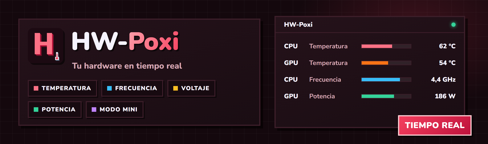

<div align="center">



<br />


[](LICENSE)

**🇪🇸 Español** · [🇬🇧 English](#-english)

### El monitor de hardware **para gaming**, en tiempo real.

Temperatura, frecuencia, carga, RAM y ventiladores de tu CPU y GPU, con mínimo, actual y máximo.
Una vista completa con gráficas de historial o un **Modo Mini** compacto encima del juego.

</div>

---

## 🎯 Qué es

**HW-Poxi** es un monitor de hardware para Windows 10 y 11 pensado para gaming. Lee los sensores reales de tu CPU y GPU
con [LibreHardwareMonitor](https://github.com/LibreHardwareMonitor/LibreHardwareMonitor), el mismo motor que usa HWMonitor,
y los enseña con una interfaz glassmorphism, gráficas de historial y bandeja del sistema.

## 📥 Descarga

| Archivo | Para qué |
|---|---|
| **[`HW-Poxi_1.0.2_x64-setup.exe`](https://github.com/PoxiiTV/HW-Poxi/releases/download/1.0.2/HW-Poxi_1.0.2_x64-setup.exe)** | **Instalador** (recomendado): instala la app y crea los accesos |
| [`HW-Poxi_1.0.2_x64.msi`](https://github.com/PoxiiTV/HW-Poxi/releases/download/1.0.2/HW-Poxi_1.0.2_x64.msi) | **Instalador MSI**: para empresas o despliegue por directiva de grupo |
| [`HW-Poxi-Portable.exe`](https://github.com/PoxiiTV/HW-Poxi/releases/download/1.0.2/HW-Poxi-Portable.exe) | **Portable**: un solo archivo, se abre sin instalar nada |

Todas las versiones y sus novedades, en [**Releases**](https://github.com/PoxiiTV/HW-Poxi/releases).

> ℹ️ Como el `.exe` aún no está firmado, Windows puede enseñar el aviso azul de SmartScreen:
> **Más información → Ejecutar de todas formas.** Al abrirse pide **administrador** para poder leer todos los sensores.
>
> ⚖️ El portable pesa unos 79 MB porque lleva dentro el sidecar de .NET 8 con su runtime. No hace falta instalar .NET aparte.

## 🌟 Qué puede hacer

| | |
|---|---|
| 🌡️ **Temperaturas reales** | De paquete y por core, en Intel y AMD Ryzen. En °C o °F |
| ⏱️ **Actualización** | Cada 0,5, 1 o 2 segundos, a tu elección |
| 📈 **Gráficas de historial** | Línea de tiempo de CPU y GPU de los últimos 60 segundos, estilo GPU-Z |
| 🔔 **Alertas de temperatura** | Aviso dentro de la app cuando la CPU o la GPU pasan del límite que elijas (**91 °C** por defecto) |
| ⚡ **Frecuencias** | MHz por core en la CPU, y core y memoria en la GPU |
| 🔋 **Potencia** | Vatios de paquete de CPU y GPU, con decimales |
| 🔌 **Voltajes** | Por core en la CPU y de core en la GPU |
| 🎮 **VRAM** | Usada y total en MB |
| 💾 **RAM** | Usada y total en GB, con porcentaje y barra de progreso |
| 🌀 **Carga GPU** | Porcentaje de uso de la GPU |
| 🌬️ **Ventiladores** | RPM del ventilador de la GPU, y de la CPU si tu placa lo expone |
| 📊 **Mín / Actual / Máx** | Apunta por sí solo el mínimo y el máximo de la sesión |
| 🖥️ **Paquete / Por core** | Cambia entre los datos globales y el detalle de cada core |
| 📌 **Modo Mini** | Overlay compacto de 340×110 px con la temperatura de CPU y GPU, y la RAM si la activas |
| 📐 **Modo Completo** | Vista de 860×580 px con todas las métricas y las gráficas |
| 🖱️ **Posición del Mini** | Recuerda dónde dejaste la ventana mini entre sesiones |
| 🎨 **Temas de color** | Azul (por defecto), Rojo, Verde y Blanco |
| 🔝 **Siempre encima** | Mantiene la ventana sobre cualquier juego o programa |
| 🔲 **Bandeja del sistema** | La X la esconde junto al reloj. Clic izquierdo para mostrar u ocultar, clic derecho para Mostrar, Modo Mini o Salir |
| 📥 **Exportar CSV** | Guarda el historial de sensores de la sesión en tu carpeta Descargas |
| 📦 **Un solo .exe** | El sidecar de C# va embebido: no hay archivos extra que repartir |

### 📊 Sensores disponibles

| Sensor | Intel CPU | AMD Ryzen | NVIDIA GPU | AMD GPU |
|--------|:---------:|:---------:|:----------:|:-------:|
| Temp. paquete | ✅ | ✅ | ✅ | ✅ |
| Temp. por core | ✅ | ✅ | · | · |
| Frecuencia por core | ✅ | ✅ | · | · |
| Frecuencia GPU core/mem | · | · | ✅ | ✅ |
| Voltaje por core | ✅ | ✅ | · | · |
| Potencia paquete | ✅ | ✅ | ✅ | ✅ |
| Carga GPU % | · | · | ✅ | ✅ |
| Ventilador GPU RPM | · | · | ✅ | ✅ |
| VRAM | · | · | ✅ | ✅ |
| RAM sistema | ✅ | ✅ | ✅ | ✅ |

## 🚀 Cómo se usa

1. Abre **HW-Poxi** y acepta el aviso de administrador (UAC).
2. En la vista completa ves la CPU y la GPU. Cambia entre **Paquete** y **Por core** en la tarjeta de la CPU.
3. Pulsa el botón de **Modo mini** en la barra de título para pasar al overlay compacto, y arrástralo donde quieras.
4. Pulsa la **X** para esconderla en la bandeja. Para cerrarla del todo, clic derecho en el icono y **Salir**.

> 💡 En **Ajustes** eliges el tema, la unidad (°C o °F), cada cuánto se actualiza, el límite de la alerta,
> si el Mini enseña la RAM y si la ventana va siempre encima. Desde ahí también exportas el CSV.

## ⚠️ Avisos

- Pide **administrador** al abrirse. Sin esos permisos no se pueden leer los voltajes ni algunos datos por core.
- Los sensores que ves dependen de tu **hardware**: si la placa o la tarjeta no exponen un dato (por ejemplo el ventilador de la CPU), no aparece.
- **Bandeja en Windows 11:** la X no cierra la app, la esconde en la bandeja. Si no ves el icono, búscalo en el menú de desbordamiento (la flecha `^` junto al reloj) y fíjalo para tenerlo siempre a la vista.

## 🔧 Compilar

Necesitas [Node.js](https://nodejs.org), [Rust](https://rustup.rs), el [SDK de .NET 8](https://dotnet.microsoft.com/download) y Visual Studio C++ Build Tools.

```bash
npm install

# 1. Sidecar de C# (lee los sensores con LibreHardwareMonitor)
cd hw-sidecar
dotnet publish -c Release -r win-x64 --self-contained true -p:PublishSingleFile=true -p:IncludeNativeLibrariesForSelfExtract=true -o publish
cd ..

# 2. App de Tauri con el sidecar embebido: instalador NSIS + MSI
cargo tauri build
```

`start.bat` compila el sidecar y arranca el modo desarrollo. `deploy.bat` hace el build completo y copia el portable y los instaladores a `deploy-hosting/`.

## 📋 Historial de versiones

Todas las novedades, en español e inglés, en el [**historial de versiones**](#-changelog) al final de esta página.

## 📜 Licencia

**HW-Poxi** se distribuye bajo la **PolyForm Noncommercial License 1.0.0** 🔒.

Libre para **uso personal**: vigilar tu hardware, aprender y experimentar. Prohibido el **uso comercial**: no se puede vender ni sacar beneficio económico con este proyecto. Texto completo en [`LICENSE`](LICENSE).

---
<br />

<a id="-english"></a>

<div align="center">

**[🇪🇸 Español](#)** · **🇬🇧 English**

### The **gaming** hardware monitor, in real time.

Temperature, clocks, load, RAM and fans for your CPU and GPU, with min, current and max.
A full view with history charts, or a compact **Mini mode** on top of your game.

</div>

## 🎯 What it is

**HW-Poxi** is a gaming-oriented hardware monitor for Windows 10 and 11. It reads the real sensors of your CPU and GPU
through [LibreHardwareMonitor](https://github.com/LibreHardwareMonitor/LibreHardwareMonitor), the same engine HWMonitor uses,
and shows them in a glassmorphism interface with history charts and a system tray icon.

## 📥 Download

| File | What for |
|---|---|
| **[`HW-Poxi_1.0.2_x64-setup.exe`](https://github.com/PoxiiTV/HW-Poxi/releases/download/1.0.2/HW-Poxi_1.0.2_x64-setup.exe)** | **Installer** (recommended): installs the app and creates shortcuts |
| [`HW-Poxi_1.0.2_x64.msi`](https://github.com/PoxiiTV/HW-Poxi/releases/download/1.0.2/HW-Poxi_1.0.2_x64.msi) | **MSI installer**: for companies or Group Policy deployment |
| [`HW-Poxi-Portable.exe`](https://github.com/PoxiiTV/HW-Poxi/releases/download/1.0.2/HW-Poxi-Portable.exe) | **Portable**: a single file, runs without installing anything |

All versions and release notes live in [**Releases**](https://github.com/PoxiiTV/HW-Poxi/releases).

> ℹ️ The `.exe` is not code-signed yet, so Windows may show the blue SmartScreen warning:
> **More info → Run anyway.** On launch it asks for **administrator** rights so it can read every sensor.
>
> ⚖️ The portable is about 79 MB because it carries the .NET 8 sidecar and its runtime. You don't need to install .NET separately.

## 🌟 What it can do

| | |
|---|---|
| 🌡️ **Real temperatures** | Package and per-core, on Intel and AMD Ryzen. In °C or °F |
| ⏱️ **Refresh rate** | Every 0.5, 1 or 2 seconds, your choice |
| 📈 **History charts** | 60-second CPU and GPU timeline, GPU-Z style |
| 🔔 **Temperature alerts** | In-app warning when the CPU or GPU goes over your limit (**91 °C** by default) |
| ⚡ **Clocks** | MHz per core on the CPU, core and memory on the GPU |
| 🔋 **Power** | CPU and GPU package watts, with decimals |
| 🔌 **Voltages** | Per core on the CPU and core voltage on the GPU |
| 🎮 **VRAM** | Used and total in MB |
| 💾 **RAM** | Used and total in GB, with percentage and progress bar |
| 🌀 **GPU load** | GPU usage percentage |
| 🌬️ **Fans** | GPU fan RPM, and CPU fan if your board exposes it |
| 📊 **Min / Current / Max** | Tracks the session's lowest and highest values on its own |
| 🖥️ **Package / Per-core** | Switch between global data and each core's detail |
| 📌 **Mini mode** | Compact 340×110 px overlay with CPU and GPU temperature, plus RAM if you turn it on |
| 📐 **Full mode** | 860×580 px view with every metric and the charts |
| 🖱️ **Mini position** | Remembers where you left the mini window between sessions |
| 🎨 **Color themes** | Blue (default), Red, Green and White |
| 🔝 **Always on top** | Keeps the window above any game or app |
| 🔲 **System tray** | The X hides it next to the clock. Left-click to show or hide, right-click for Show, Mini mode or Quit |
| 📥 **Export CSV** | Saves the session's sensor history to your Downloads folder |
| 📦 **Single .exe** | The C# sidecar is embedded: no extra files to ship |

### 📊 Available sensors

| Sensor | Intel CPU | AMD Ryzen | NVIDIA GPU | AMD GPU |
|--------|:---------:|:---------:|:----------:|:-------:|
| Package temp | ✅ | ✅ | ✅ | ✅ |
| Per-core temp | ✅ | ✅ | · | · |
| Per-core clock | ✅ | ✅ | · | · |
| GPU core/mem clock | · | · | ✅ | ✅ |
| Per-core voltage | ✅ | ✅ | · | · |
| Package power | ✅ | ✅ | ✅ | ✅ |
| GPU load % | · | · | ✅ | ✅ |
| GPU fan RPM | · | · | ✅ | ✅ |
| VRAM | · | · | ✅ | ✅ |
| System RAM | ✅ | ✅ | ✅ | ✅ |

## 🚀 How to use it

1. Open **HW-Poxi** and accept the administrator (UAC) prompt.
2. The full view shows your CPU and GPU. Switch between **Package** and **Per-core** on the CPU card.
3. Hit the **Mini mode** button in the title bar to switch to the compact overlay, and drag it wherever you want.
4. Press the **X** to hide it in the tray. To quit for good, right-click the icon and pick **Quit**.

> 💡 In **Settings** you pick the theme, the unit (°C or °F), the refresh rate, the alert limit,
> whether Mini shows RAM and whether the window stays on top. You also export the CSV from there.

## ⚠️ Notes

- It asks for **administrator** rights on launch. Without them it can't read voltages and some per-core data.
- The sensors you see depend on your **hardware**: if the board or card doesn't expose a value (the CPU fan, for example), it won't show up.
- **Tray on Windows 11:** the X doesn't close the app, it hides it in the tray. If you can't see the icon, look in the overflow menu (the `^` arrow next to the clock) and pin it so it stays visible.

## 🔧 Build

You need [Node.js](https://nodejs.org), [Rust](https://rustup.rs), the [.NET 8 SDK](https://dotnet.microsoft.com/download) and Visual Studio C++ Build Tools.

```bash
npm install

# 1. C# sidecar (reads the sensors through LibreHardwareMonitor)
cd hw-sidecar
dotnet publish -c Release -r win-x64 --self-contained true -p:PublishSingleFile=true -p:IncludeNativeLibrariesForSelfExtract=true -o publish
cd ..

# 2. Tauri app with the sidecar embedded: NSIS installer + MSI
cargo tauri build
```

`start.bat` builds the sidecar and starts development mode. `deploy.bat` runs the full build and copies the portable and the installers to `deploy-hosting/`.

## 📋 Version history

Every release note, in Spanish and English, is in the [**changelog**](#-changelog) below.

## 📜 License

**HW-Poxi** is released under the **PolyForm Noncommercial License 1.0.0** 🔒.

Free for **personal use**: monitor your hardware, learn and experiment. **Commercial use** is not allowed: you may not sell it or make money from this project. Full text in [`LICENSE`](LICENSE).

---
<br />

<a id="-changelog"></a>

## 📋 Historial de versiones / Changelog

### v1.0.2: Icono nuevo / New icon

**🇪🇸 Español**

- **Icono nuevo:** HW-Poxi estrena icono con el estilo de la familia de programas de Poxi: una H pixelada con un termómetro.
- **Nítido en cualquier tamaño:** el icono incluye versiones dibujadas a mano para 16, 20, 24, 32, 40, 48, 64, 128 y 256 px, así se ve limpio en la barra de tareas, el explorador y el escritorio.

**🇬🇧 English**

- **New icon:** HW-Poxi gets a new icon in the style of the Poxi app family: a pixel-art H with a thermometer.
- **Sharp at every size:** the icon ships hand-drawn versions for 16, 20, 24, 32, 40, 48, 64, 128 and 256 px, so it looks clean in the taskbar, Explorer and on the desktop.

### v1.0.1: Corrección del Modo Mini / Mini mode fix

**🇪🇸 Español**

- **Corregido: el Modo Mini no se veía.** Al minimizar la app estando en modo mini, Windows reporta la posición `-32000, -32000` (valor interno de ventana minimizada) y esa coordenada se guardaba como si fuera la posición elegida por el usuario. En los siguientes arranques la ventana mini se restauraba fuera de la pantalla: existía y funcionaba, pero era invisible.
- **Validación de posición:** al restaurar la ventana mini se comprueba que la posición caiga dentro de un monitor conectado. Si no, la ventana se centra automáticamente. Esto también cubre cambios de resolución y desconectar una pantalla secundaria.
- **Tamaño en unidades lógicas:** el modo mini usaba píxeles físicos, por lo que en pantallas con escalado de Windows (125 % / 150 %) la vista quedaba aplastada bajo la barra de título.

**🇬🇧 English**

- **Fixed: Mini mode was invisible.** Minimizing the app while in mini mode made Windows report position `-32000, -32000` (its internal marker for a minimized window), and that coordinate was saved as if the user had chosen it. On later launches the mini window was restored off-screen: present and working, but invisible.
- **Position validation:** the restored mini window position is now checked against the connected monitors. If it falls outside all of them, the window is centered automatically. This also covers resolution changes and unplugging a secondary display.
- **Logical size units:** mini mode used physical pixels, so on scaled Windows displays (125% / 150%) the view was squashed under the title bar.

### v1.0.0: Lanzamiento inicial / Initial release

**🇪🇸 Español**

- **Vista completa:** CPU y GPU con temperaturas, frecuencias, voltajes, potencia, carga y ventiladores
- **Vista por core:** detalle individual de cada core de CPU (temperatura, frecuencia, voltaje)
- **Gráficas de historial:** línea de tiempo CPU + GPU de los últimos 60 segundos, estilo GPU-Z
- **RAM del sistema:** usada / total en GB con porcentaje y barra de progreso (vía Windows API directa)
- **Alertas de temperatura:** aviso in-app cuando CPU o GPU supera el umbral configurable (91 °C por defecto, cooldown de 30 s)
- **Modo Mini:** overlay compacto siempre encima, con RAM opcional activable en ajustes
- **Posición mini persistente:** recuerda dónde dejaste la ventana mini al cerrar
- **Bandeja del sistema:** la X minimiza a tray; clic izquierdo muestra/oculta; menú derecho con Mostrar / Modo Mini / Salir
- **Temas de color:** Azul (por defecto), Rojo gaming, Verde, Blanco
- **Exportar CSV:** guarda el historial de sensores de la sesión en Descargas
- **Ejecutable único:** el sidecar C# va embebido; sin archivos extra que distribuir
- **UAC automático:** solicita permisos de administrador al abrir para acceso completo al hardware

**🇬🇧 English**

- **Full view:** CPU and GPU with temperatures, clocks, voltages, power, load and fans
- **Per-core view:** individual core detail for CPU (temperature, clock, voltage)
- **History charts:** 60-second CPU + GPU temperature timeline, GPU-Z style
- **System RAM:** used / total GB with percentage and progress bar (via direct Windows API)
- **Temperature alerts:** in-app notification when CPU or GPU exceeds configurable threshold (91°C default, 30 s cooldown)
- **Mini mode:** compact always-on-top overlay with optional RAM toggle in settings
- **Persistent mini position:** remembers where you left the mini window on close
- **System tray:** X minimizes to tray; left-click toggles; right-click menu: Show / Mini mode / Quit
- **Color themes:** Blue (default), Red gaming, Green, White
- **Export CSV:** saves session sensor history to Downloads
- **Single executable:** C# sidecar is embedded; no extra files to distribute
- **Auto UAC:** requests admin permissions on launch for full hardware access
